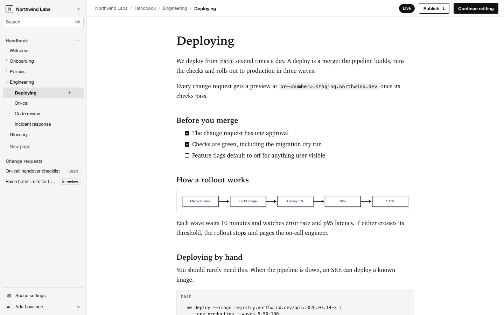
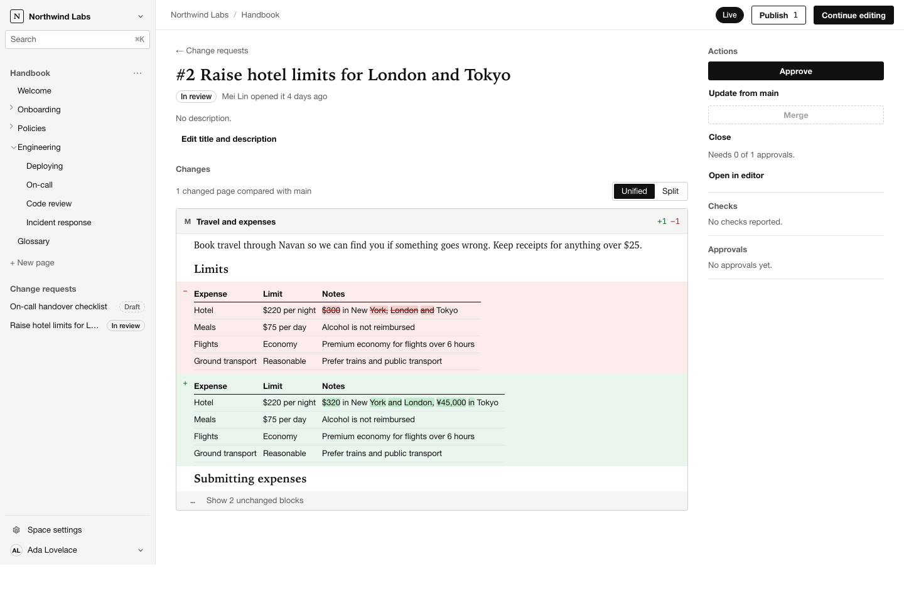
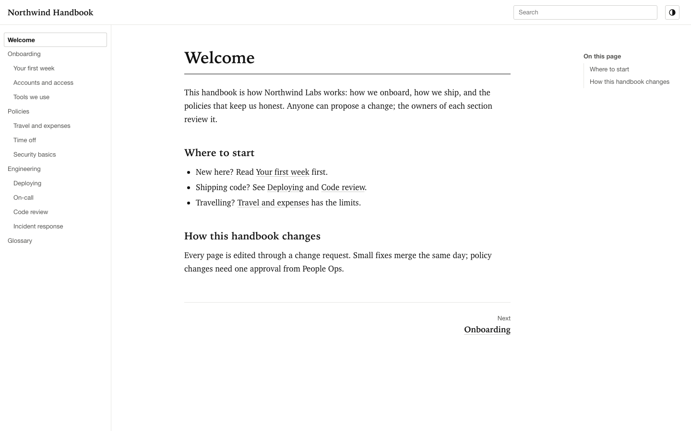
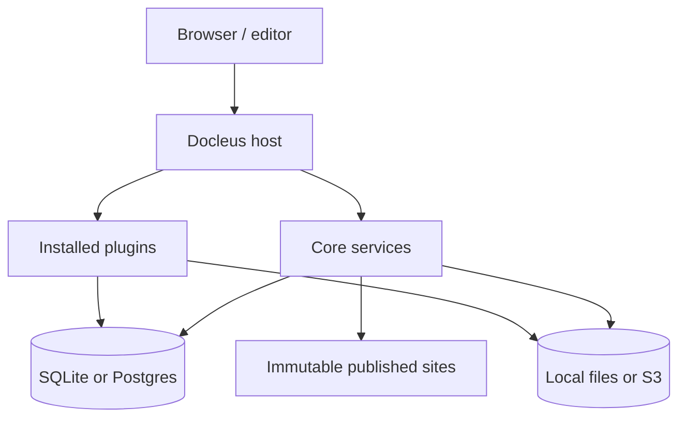

<p align="center">
  
</p>

<h1 align="center">Docleus</h1>

<p align="center">
  <strong>Documentation that works like your code.</strong><br />
  An open-source, self-hosted documentation platform with a GitBook-like workflow and a plugin-first core.
</p>

<p align="center">
  <a href="LICENSE"></a>
  <a href="#status"></a>
  
  
  
</p>

<p align="center">
  <a href="https://docleus.io">Documentation</a> &middot;
  <a href="#why-docleus">Why Docleus</a> ·
  <a href="#features">Features</a> ·
  <a href="#quick-start">Quick start</a> ·
  <a href="#architecture">Architecture</a> ·
  <a href="#plugins">Plugins</a> ·
  <a href="#contributing">Contributing</a>
</p>

> [!IMPORTANT]
> Docleus `0.0.9` is a patch preview. SDK extension points are experimental. Packages remain private; deployment does not require npm packages.



<p align="center">
  <sub>Write and review in the editor. Changes move through branches and change requests before they reach the published site.</sub>
</p>

## Why Docleus

Docleus gives a team a focused writing and publishing workflow without turning the documentation platform into a black box.

- **Write together.** Edit the same page with your team, then review changes in the context of the document.
- **Review before publishing.** Branches and change requests keep drafts separate from the live site.
- **Own the deployment.** Run Docleus on your infrastructure with SQLite and local files, or Postgres and S3-compatible storage.
- **Extend the platform.** The core is deliberately small. Official features use the same public extension points available to third-party plugins.
- **Keep content portable.** Source-preserving Markdown codecs and versioned blocks make it possible to change plugins without losing content.

## Features

### Editing and collaboration

- A block editor built on Tiptap and ProseMirror.
- Real-time collaboration with Yjs and Hocuspocus.
- Page trees, organization and space permissions, invitations, and SSO through OIDC.
- A command palette and search across pages.

### Review and publishing

- Change requests with checks, approvals, and block-level three-way merges.
- Immutable site publications with publication history and rollback.
- Custom domains, responsive themes, full-text site search, and `llms.txt`.
- Static site export for hosting somewhere else.

### Extensibility

- A TypeScript plugin SDK with typed services, events, routes, jobs, UI slots, and settings pages.
- Runtime plugin installation without restarting the instance.
- Official plugins for the editor, themes, search, collaboration, change requests, Mermaid, OIDC, and S3.
- Conformance suites for core service implementations.

|                                                        Review changes like code                                                        |                                  Publish a site you control                                  |
| :------------------------------------------------------------------------------------------------------------------------------------: | :------------------------------------------------------------------------------------------: |
|  |  |

## Quick start

Read the [online documentation](https://docleus.io/) for product and deployment
guides. The [developer documentation](https://docleus.io/developers/) covers
running from source, building plugins, the SDK, testing, and packaging.

### Prerequisites

- Docker with Compose v2.
- No source checkout or local Node.js installation is required for the prebuilt image.

Download the small deployment from the [0.0.9 release](https://github.com/Docleus/docleus/releases/tag/v0.0.9) once it includes the container record and Compose attachments, then start the image:

```sh
mkdir docleus && cd docleus
curl -fLO https://github.com/Docleus/docleus/releases/download/v0.0.9/compose.small.yaml
docker compose -f compose.small.yaml pull
docker compose -f compose.small.yaml up -d
docker compose -f compose.small.yaml logs docleus
```

Open [http://localhost:3000/setup](http://localhost:3000/setup) and enter the setup token printed in the container logs. The small deployment uses one container, SQLite, and local files in the `docleus-data` volume. Keep the setup token private.

The container delivery target is `ghcr.io/docleus/docleus:0.0.9` for Linux AMD64
and ARM64. Use it once the release includes `container-0.0.9.json` and the Compose
attachments; the source preview can be published before those assets. The
container record supplies the exact image digest, source checksum, platforms,
and build run. For a fixed deployment, set `DOCLEUS_IMAGE` to its `reference`
value. [Build from source](DEPLOYMENT.md#build-the-image) when those assets are
not available or when developing the platform.

### Production-shaped deployment

The standard compose file uses Postgres and an S3-compatible store:

```sh
curl -fLO https://github.com/Docleus/docleus/releases/download/v0.0.9/compose.yaml
curl -fLO https://github.com/Docleus/docleus/releases/download/v0.0.9/default.env.example
cp default.env.example .env
# Set POSTGRES_PASSWORD, S3_ACCESS_KEY, S3_SECRET_KEY, and S3_SIGNING_SECRET.
docker compose up -d
```

Put Docleus behind a TLS-terminating reverse proxy and set `DOCLEUS_PUBLIC_URL` plus `DOCLEUS_TRUST_PROXY=true`. See `Caddyfile.example` for a starting point.

<details>
<summary>Common configuration</summary>

| Variable                                | Purpose                                            |
| --------------------------------------- | -------------------------------------------------- |
| `DOCLEUS_DATABASE_URL`                  | Postgres connection string; omit it to use SQLite. |
| `DOCLEUS_PUBLIC_URL`                    | Public URL used in invitation and setup links.     |
| `DOCLEUS_TRUST_PROXY`                   | Trust forwarding headers from a reverse proxy.     |
| `DOCLEUS_BLOB_SECRET`                   | Sign local blob URLs; at least 32 characters.      |
| `DOCLEUS_SMTP_URL`, `DOCLEUS_SMTP_FROM` | Send invitation email.                             |
| `DOCLEUS_OIDC_*`                        | Configure an OpenID Connect identity provider.     |
| `DOCLEUS_S3_*`                          | Enable S3-compatible blob storage.                 |

Secrets stay in the environment. Non-secret settings are written to `/data/docleus.yaml` and can also be edited directly.

</details>

## Architecture



The kernel, SDK, and core services live in `docleus-core`. The default distribution links the sibling core and plugin checkouts. A release records their exact commits and the resulting image digest. Official and third-party plugins depend on the public SDK rather than on core internals.

[`component-releases.json`](component-releases.json) pins this distribution's
component versions, source commits, Git trees, release links, and component
metadata checksums. The complete release source bundle preserves this component
set; ordinary sibling source checkouts follow the checked-out revisions.

| Repository                                                                      | Responsibility                                                           |
| ------------------------------------------------------------------------------- | ------------------------------------------------------------------------ |
| [`docleus`](https://github.com/Docleus/docleus)                                 | Distribution, Docker image, compose templates, and default plugin bundle |
| [`docleus-core`](https://github.com/Docleus/docleus-core)                       | Vendored Cordis kernel, plugin SDK, core services, and browser host      |
| [`docleus-plugin-template`](https://github.com/Docleus/docleus-plugin-template) | Starting point for a new plugin                                          |
| `docleus-plugin-*`                                                              | Official plugins, each in its own repository                             |

See [deployment and operations](DEPLOYMENT.md) for configuration, runtime plugin
installation, backups, upgrades, and static export. The core and plugin READMEs
document the implemented APIs and their constraints.

## Plugins

The default bundle includes the features most documentation teams expect:

| Plugin                                                                                             | Adds                                          |
| -------------------------------------------------------------------------------------------------- | --------------------------------------------- |
| [`@docleus/plugin-blocks-commonmark`](https://github.com/Docleus/docleus-plugin-blocks-commonmark) | CommonMark blocks and Markdown codecs         |
| [`@docleus/plugin-editor`](https://github.com/Docleus/docleus-plugin-editor)                       | Tiptap/ProseMirror editing                    |
| [`@docleus/plugin-theme-default`](https://github.com/Docleus/docleus-plugin-theme-default)         | Responsive default site theme                 |
| [`@docleus/plugin-change-requests`](https://github.com/Docleus/docleus-plugin-change-requests)     | Draft branches, checks, approvals, and merges |
| [`@docleus/plugin-collab`](https://github.com/Docleus/docleus-plugin-collab)                       | Real-time collaborative editing               |
| [`@docleus/plugin-search-db`](https://github.com/Docleus/docleus-plugin-search-db)                 | Editor and published-site search              |
| [`@docleus/plugin-mermaid`](https://github.com/Docleus/docleus-plugin-mermaid)                     | Mermaid diagrams                              |
| [`@docleus/plugin-llms-txt`](https://github.com/Docleus/docleus-plugin-llms-txt)                   | `llms.txt` output                             |
| [`@docleus/plugin-auth-oidc`](https://github.com/Docleus/docleus-plugin-auth-oidc)                 | OpenID Connect sign-in                        |
| [`@docleus/plugin-blobs-s3`](https://github.com/Docleus/docleus-plugin-blobs-s3)                   | S3-compatible blob storage                    |

OIDC and S3 are included but disabled until configured. Verify the exact core and plugin versions in [COMPATIBILITY.md](COMPATIBILITY.md).

## Documentation

- [Deployment and operations](DEPLOYMENT.md)
- [Online documentation](https://docleus.io)
- [Developer guides](https://docleus.io/developers/)
- [Changelog](CHANGELOG.md)
- [Core and SDK](https://github.com/Docleus/docleus-core)
- [Plugin template](https://github.com/Docleus/docleus-plugin-template)

## Status

The first `0.0.1` preview was released on November 3, 2026. Patch `0.0.9` verifies S3 read-token expiry with the injected service clock while preserving token encoding, HMAC checks and the existing expiry boundary. Container delivery is recorded separately in the release's container assets.

Git Sync, a stable plugin SDK, collections, AI/MCP features, and visitor-aware
publishing are planned for later phases. Roadmap details will be published in
the documentation when they are ready.

## Contributing

Contributions are welcome. Open an issue before a large or cross-repository change so the design and scope can be agreed on first.

Use Node.js 24 and pnpm 11.21.0 for source development. Install core first, then
each sibling repository, with `pnpm install --frozen-lockfile`.

Run `pnpm check` in every repository you change. If a change affects the SDK or
a public core package, also run the plugin compatibility checks from the
maintainers' side-by-side checkout.

## Community

[Contributing](https://github.com/Docleus/.github/blob/main/CONTRIBUTING.md) &middot;
[Code of conduct](https://github.com/Docleus/.github/blob/main/CODE_OF_CONDUCT.md) &middot;
[Security](https://github.com/Docleus/.github/blob/main/SECURITY.md) &middot;
[Support](https://github.com/Docleus/.github/blob/main/SUPPORT.md)

## License

[MIT](LICENSE)
